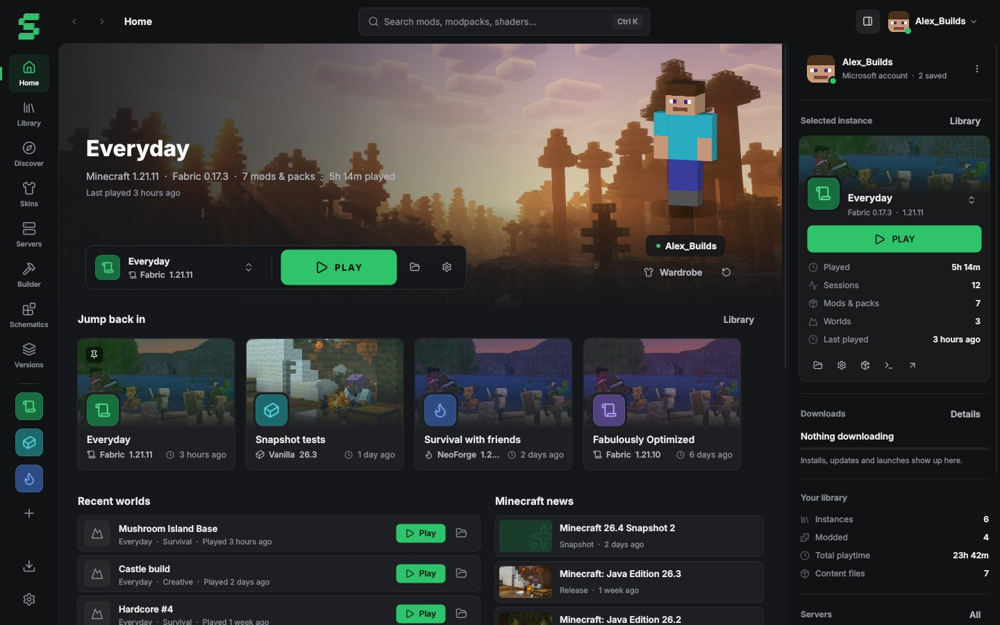
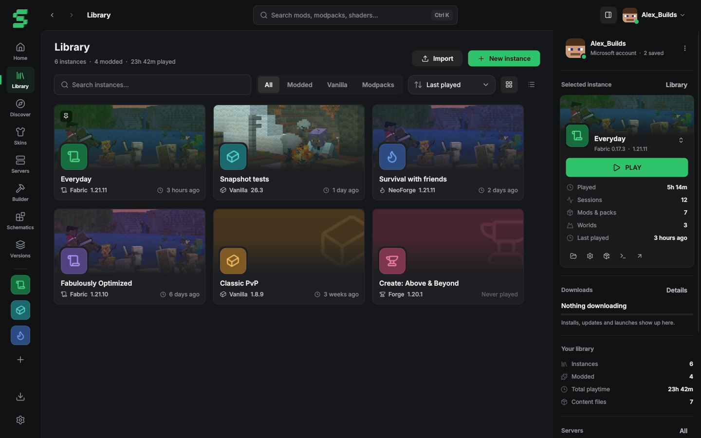
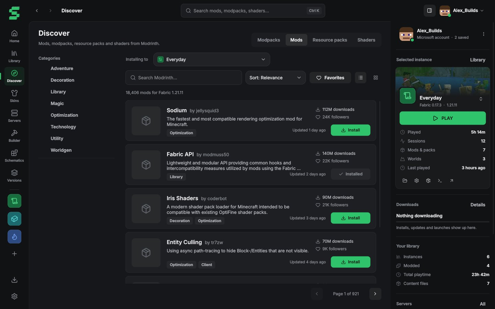
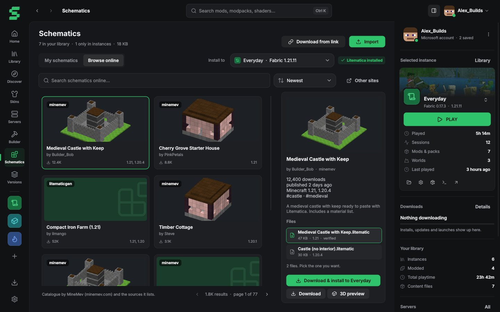
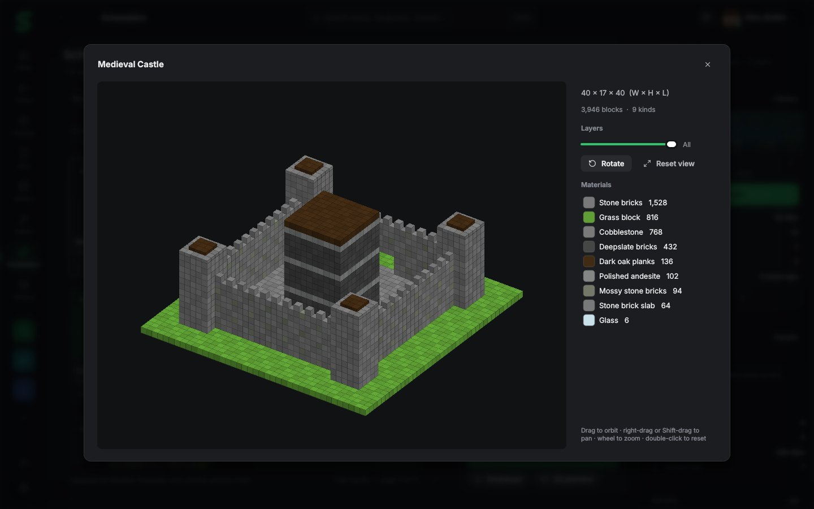

# Svax Launcher

A free desktop launcher for **Minecraft: Java Edition** on Windows, made for me, my friends and a small community.

## What it does

- Separate game instances for every Minecraft release and snapshot, with Vanilla, Fabric, Quilt, Forge or NeoForge.
- Installs mods, modpacks (`.mrpack`), resource packs and shaders from [Modrinth](https://modrinth.com), with dependency resolution and SHA-512 verification.
- Manages worlds, screenshots, saved servers (live status), skins and play time.
- A live game log, crash detection, and background downloads while you keep using the launcher.
- Litematica schematics: your own library, one-click install into instances, an online catalogue to find new builds, and a 3D preview with layers and a material list.

## Sign-in and privacy

- Players sign in with **their own Microsoft account that owns Minecraft: Java Edition**. Sign-in uses the standard Microsoft OAuth 2.0 authorization-code flow with PKCE in the system browser and a local loopback redirect (`http://localhost:8976/callback`). The launcher never sees or stores passwords and uses no client secret.
- Refresh tokens are stored only on the player's PC, in Windows Credential Manager.
- The launcher collects no analytics or personal data, has no ads and no paid features, and does not offer offline/"cracked" accounts or any way around game ownership.
- It follows the Minecraft EULA and the Minecraft Usage Guidelines.

## Download

Windows 10/11: download `SvaxLauncher.exe` from the [Releases](../../releases) page and run it. Settings and instances are kept in `%LOCALAPPDATA%\SvaxClient`.

---

Svax Launcher is an independent project. NOT AN OFFICIAL MINECRAFT PRODUCT. NOT APPROVED BY OR ASSOCIATED WITH MOJANG OR MICROSOFT.
